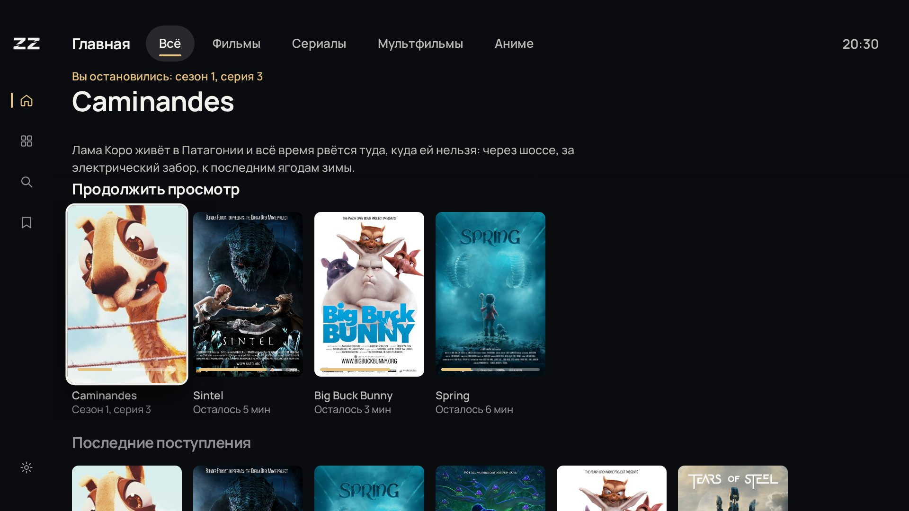
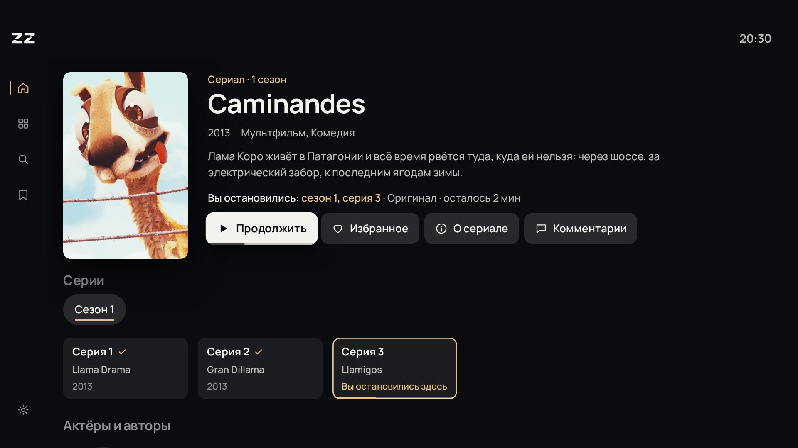
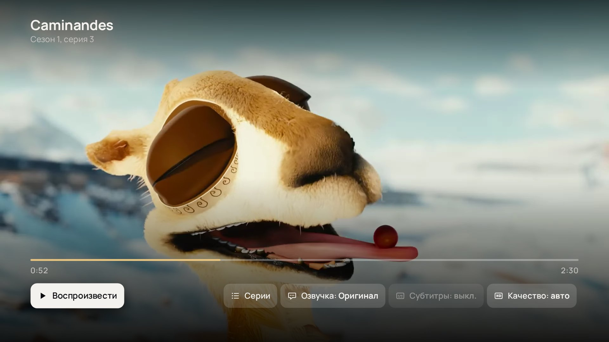
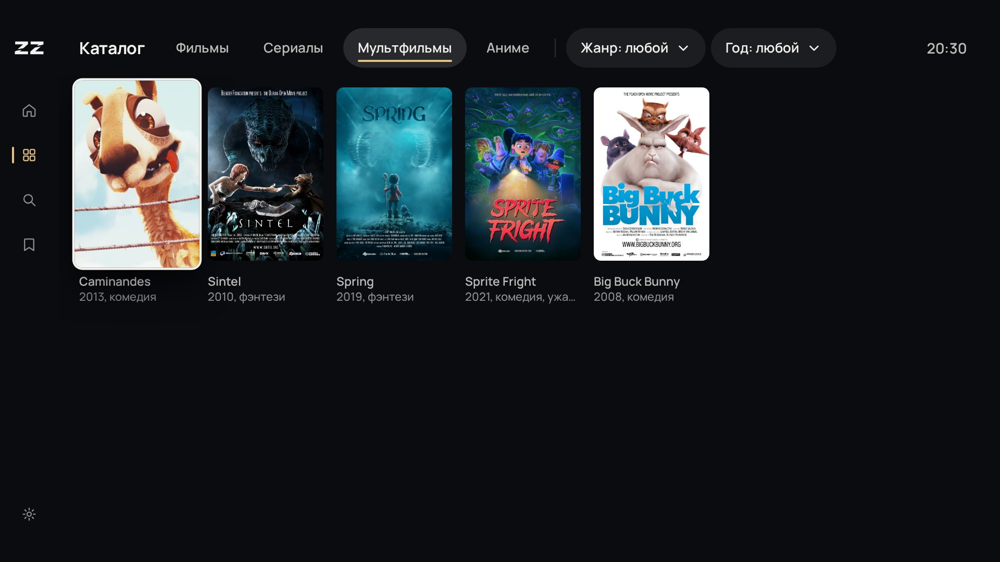

# Rezzka

Приложение для телевизоров LG с webOS: каталог фильмов и сериалов с выбранного зеркала, карточки и плеер, рассчитанные на пульт.

  
  
  
  

Скриншоты сделаны на демонстрационных данных с фильмами Blender Foundation под лицензией CC BY, источники перечислены в [docs/screenshots/CREDITS.md](docs/screenshots/CREDITS.md).

## Что умеет

- Главная, каталог с фильтрами по типу, жанру и году, поиск.
- Карточка на одной странице: озвучки, сезоны и серии с датами выхода, актёры, части франшизы и похожие фильмы.
- Плеер: качество, субтитры, кадр под курсором при перемотке, автозапуск следующей серии.
- Аккаунт источника: списки "Досмотреть" и "Избранное", отметка просмотра.
- Сериалы с новыми сериями поднимаются в начало списка.
- Страницы актёров и авторов, по желанию со сведениями Кинопоиска по личному API-ключу.
- Настройки с телефона по коду доступа.
- Тёмная и светлая темы, демо-режим без источника.

## Установка на телевизор

Rezzka нет в LG Content Store, пакет ставится вручную.

1. Скачайте `ru.kamilov.rezzka_<версия>_all.ipk` и файл `.sha256` со страницы Releases и сверьте контрольную сумму: `sha256sum -c ru.kamilov.rezzka_<версия>_all.ipk.sha256`.
2. Установите на телевизор приложение Developer Mode из LG Content Store, войдите в аккаунт LG Developer, включите Dev Mode Status и Key Server.
3. Установите пакет через [webOS Dev Manager](https://github.com/webosbrew/dev-manager-desktop) или командой `ares-install --device tv ru.kamilov.rezzka_<версия>_all.ipk`. Здесь `tv` - имя телевизора, зарегистрированного через `ares-setup-device`.

Сессию режима разработчика нужно продлевать в приложении Developer Mode. Если она закончится, телевизор может удалить установленные пакеты.

Для обновления установите новый пакет поверх старого.

## Что важно знать

- Пароль не сохраняется, на телевизоре хранится только сессия. Выход и смена зеркала её удаляют.
- Точная позиция просмотра остаётся на телевизоре, в аккаунт уходят только фильм, озвучка и серия.
- Настройка с телефона идёт по локальной сети через HTTP без шифрования, доступ ограничен кодом и временем.
- Озвучки Premium доступны только с аккаунтом Premium.
- Проверку браузера и CAPTCHA приложение не обходит.

## Совместимость

Проверено на LG OLED55C6 с webOS 11.2. Другие модели и версии webOS не проверялись.

Это неофициальный клиент. Проект не связан с администрацией сайта-источника и не хранит видео. Если сайт изменится, каталог или плеер могут не работать до выхода обновления.

## Разработка

Запуск на компьютере, проверки, сборка и устройство приложения описаны в документе [Разработка и отладка](docs/development.md).
